# Architecture

Resume AI prepares job applications from a candidate's own evidence. The design rule throughout is that
**a model may propose, but deterministic code decides**: every claim in an output document has to trace back to
an evidence item with a provenance record, and the system records — but never performs — a submission.

```mermaid
flowchart LR
    subgraph Inputs
        P[Job postings]
        E[Candidate evidence<br/>notes, repos, documents]
        PR[Evidence bank<br/>profile JSON: items with status + source]
    end

    subgraph Matching["matching/engine.py"]
        M1[Alias normalisation<br/>posting terms to canonical skills]
        M2[Status-weighted score<br/>VERIFIED 1.0 / IN_PROGRESS 0.5 / PLANNED 0]
        M3[Gaps, experience level,<br/>family, priority, fingerprint]
    end

    subgraph RAG["rag/ (scoped evidence retrieval)"]
        R1[Ledger ingestion<br/>tenant + candidate scope, append-only events]
        R2[Structural chunking<br/>exact Unicode offsets, claim links]
        R3[Embeddings<br/>MiniLM pinned or demo hashing]
        R4[SQLite reference vector store<br/>exact cosine, lifecycle states]
        R5[Hybrid retrieval<br/>BM25 + vector, RRF, dedup]
        R6[Component retrieval<br/>requirement decomposition, fair merge]
        R7[Context contract<br/>citations, untrusted-data envelope]
    end

    subgraph Grounding["agents/ + grounding/"]
        G1[LLM spec<br/>evidence ids only]
        G2[spec_issues + claim validator]
        G3[DOCX renderer<br/>bullets copied from evidence]
        G4[Re-validate rendered text]
    end

    subgraph Tracking["tracking/tracker.py (SQLite)"]
        T1[jobs, assessments, snapshots]
        T2[documents, approvals, activity<br/>append-only triggers]
        T3[Submission guard triggers<br/>applications + jobs status<br/>need a candidate approval row]
    end

    P --> M1 --> M2 --> M3 --> T1
    PR --> M2
    E --> R1 --> R2 --> R3 --> R4 --> R5 --> R6 --> R7
    P --> R5
    R7 -. context for generation .-> G1
    PR --> G1 --> G2
    G2 -- issues fed back, retry --> G1
    G2 -- clean --> G3 --> G4 --> T2
    T2 --> T3
    H((Candidate)) -- approves / submits by hand --> T3
```

## Components

### Evidence bank (`grounding/profile.py`)
Each evidence item has a role, a text, a `source` (provenance) and one status:
`VERIFIED`, `ATTESTED`, `IN_PROGRESS`, `PLANNED`, `DISPUTED`. Skills map to a status and the evidence ids
that back them. `PLANNED` and `DISPUTED` items can never appear in a document; `IN_PROGRESS` items must be
labelled as ongoing.

### Matching (`matching/engine.py`)
Posting terms (key technologies plus terms found in the required qualifications) are normalised through an
alias table. Each term contributes its evidence weight; required terms count 1.5x; unknown terms count as
half-weight unassessed. A term is a gap when it maps to a skill the profile does not list or when the
profile declares it in `gaps`; gaps the profile marks as `hard_gaps`, required research track records and
over-level experience requirements subtract fixed penalties; thin postings are capped. The explanation (verified / in progress /
planned / gaps / experience) is stored with every assessment. Duplicate postings are caught by canonical URL
(tracking parameters dropped) or a company+title+country fingerprint.

### Retrieval (`rag/`)
This is the most developed part of the project (Stages 3A–3J of the original work).

* **Scope and trust.** Every object carries a `Scope(tenant_id, candidate_id)`. Stores, chunk services,
  retrievers and rerankers refuse foreign-scope objects. All evidence text is `untrusted_data`; embeddings
  cannot promote trust.
* **Ingestion.** Source adapters normalise documents into immutable `Evidence` with a native locator;
  re-ingesting identical content is idempotent; new content supersedes the previous version.
* **Chunking.** Boundary priorities: supplied structure and claim spans, paragraphs, sentences, words. Fenced
  code and heading+line pairs are kept whole when they fit. Chunks keep exact half-open Unicode offsets so a
  citation can be checked against the stored source text.
* **Embeddings.** `LocalTransformerProvider` (mean pooling, L2-normalised, refuses truncation) was used with
  `sentence-transformers/all-MiniLM-L6-v2` at a pinned revision. Embedding records carry the full configuration
  identity, so vectors from different models or input strategies cannot be mixed.
* **Vector store.** `SQLiteVectorStore` is an exact-cosine **reference implementation** with source-version
  activation, tombstones and stale-state handling. The original notes name PostgreSQL + pgvector as the
  intended production direction; that was not built.
* **Retrieval.** Semantic, BM25 or hybrid (reciprocal rank fusion, k=60), whitespace-only de-duplication with
  corroborating references kept, optional per-source cap, fail-closed if the catalogue is stale.
* **Component retrieval.** A conservative extractive decomposer splits compound requirements ("built and
  deployed X") into components, retrieves per component, and merges round-robin into a fixed budget. Each
  component is reported as `selected_candidates`, `budget_excluded` or `no_plausible_candidate_retrieved`;
  retrieval membership is explicitly not treated as proof of support.
* **Context contract.** `reasoning/contract.py` builds the model-facing JSON with chunk-level citation ids
  inside an `UNTRUSTED_RETRIEVED_EVIDENCE` envelope and strictly parses the model's labelled answer.

### Grounded generation (`agents/spec_agent.py`, `grounding/`)
The model receives the evidence digest and hard rules and returns a JSON *spec*: summary, skill lines,
evidence ids per role, cover-letter paragraphs, answers and outreach drafts. `spec_issues` rejects unknown or
unusable evidence ids, ids under the wrong role, in-progress skills outside an "(ongoing)" label, and any
free text that fails the claim validator (banned claims, numbers not present in the evidence or the posting,
unlabelled ongoing work, planned work). Rejected issues are sent back as feedback for one retry. The DOCX
renderer copies bullets verbatim from evidence ids, then the rendered text is validated again.

In the private system the model was invoked through the Claude Code CLI with a read-only tool allowlist
(`ClaudeCLI`); in the earlier v11 pipeline (archive) generation used a locally hosted open-weight model on a
university GPU cluster. Neither is required to run this repository.

### Tracking (`tracking/`)
SQLite with nine versioned migrations (1–8 from the private tracker, 9 added here). History tables (`activity`, `job_snapshots`, `assessments`,
`approvals`, `documents`, `control_history`, `browser_events`, `form_checkpoints`, `outreach_log`, `answers`)
reject UPDATE and DELETE via triggers. Database-enforced: a row in `applications` cannot become `submitted`, and
`jobs.application_status` cannot be set to `submitted` (migration 9), unless an `approvals` row with
`action='submit'`, `decision='approved'` and `actor='candidate'` exists for that job; a second submission is
refused. Python-enforced: `Tracker.set()` raises `CandidateOnlyStatus` for `approved`, `submitted`,
`interviewing`, `offer`, `rejected` and `withdrawn` (real exceptions, not `assert`, so the check survives
`python -O`). The database cannot tell who wrote an approval row, so the guarantee is that a submission is
never recorded without a candidate approval record, not that an attacker with database access is stopped. Tasks left `ACTIVE` by a
crash are re-queued on the next start. The worker control row starts `STOPPED`; only the user starts it.

## What is in the archive but not in the package

`source/v11-sealed/application/resume_pipeline/` is the v11 non-agent pipeline (raw job, retrieval, base-model
inference, extractive resume compiler, claim licensing). It needs the GPU cluster setup and is kept as-is.
Its acceptance result was **NOT READY / NO-GO** (23 of 30 cases passed; see
`source/v11-sealed/FINAL_REPORT.txt`).
